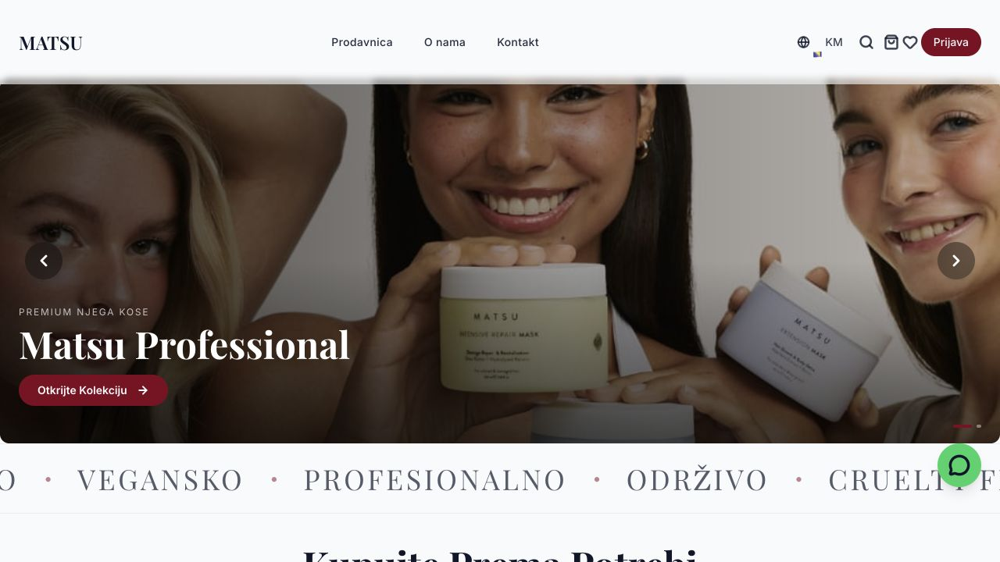
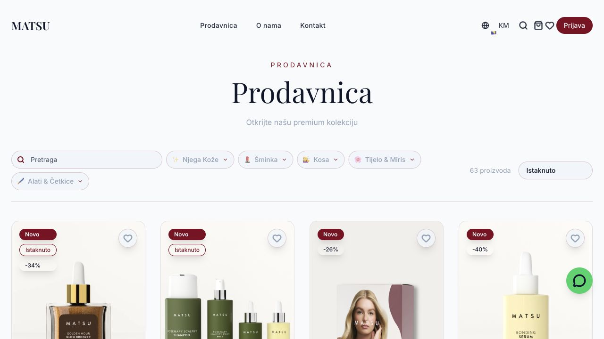
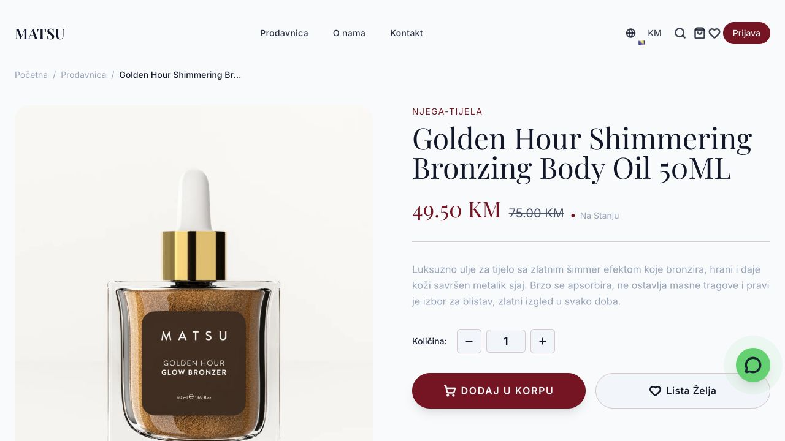

# Matsu Professional

**A localized storefront for professional hair and beauty products.**

[Visit the live product](https://matsu.ba) · [Hasan Gürel](https://hasangurel.com)

## The product

Matsu Professional is a live storefront for hair and beauty products. It combines a brand presentation with a product catalog and individual product pages.

### Development focus

- A storefront tailored to the Matsu brand.
- Product catalog, search and sorting interfaces.
- Product photography, price and availability presentation.
- Product detail pages and shopping interface.
- Localized interface and responsive component development.

## Technologies

React · TypeScript · Vite · Tailwind CSS · Supabase · TanStack Query

## Explore

[Storefront](https://matsu.ba) · [Catalog](https://matsu.ba/shop)

## Screenshots

Captured from the live public website on **8 November 2026**. Product content, visual design and prices may change.

### Product catalog and shopping controls

### Live product detail page

## Access and scope

Screenshots show publicly available storefront pages. No order was placed and no payment, customer account or private management screen is included.

Application source code is private. This repository contains a project presentation and public screenshots only. Brand names and product imagery belong to their respective owners.

---

Development portfolio by **Hasan Gürel** · [hasangurel.com](https://hasangurel.com) · [Contact](mailto:hasangurel9@hotmail.com)
